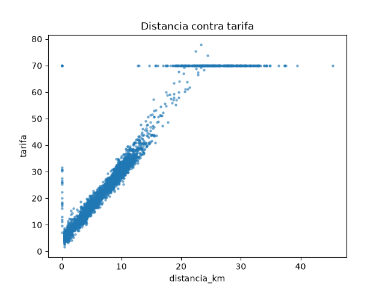

# Semana 8, Sesión 2: Exploración y visualización de datos

> Objetivo de la sesión: explorar el dataset de tu proyecto con estadística descriptiva y visualizaciones para identificar patrones, outliers y supuestos que romperían un modelo antes de entrenarlo.

**Lectura previa de esta sesión:** ["A Data Scientist's Essential Guide to Exploratory Data Analysis"](https://towardsdatascience.com/a-data-scientists-essential-guide-to-exploratory-data-analysis-25637eee0cf6/), Towards Data Science.

**Referencia de esta sesión:** [Machine Learning Zoomcamp, Módulo 1 (DataTalksClub)](https://github.com/DataTalksClub/machine-learning-zoomcamp).

## Requisitos antes de esta sesión

pandas ya lo tienes desde la Semana 4. Instala matplotlib:

```
pip install matplotlib
```

Verifica con:

```
python3 -c "import matplotlib; print(matplotlib.__version__)"
```

Los scripts de hoy guardan cada gráfico como imagen en una carpeta `figuras/`. También puedes correr el mismo código en un notebook de Jupyter, donde el gráfico aparece debajo de la celda.

## Antes de empezar

A partir de la lectura previa:

**Según el artículo, ¿qué preguntas responde la exploración de datos antes de entrenar cualquier modelo?**

El artículo organiza la exploración en tres tareas, y cada una responde un grupo de preguntas:

1. **Vista general y estadística descriptiva:** ¿cuántas filas y columnas hay?, ¿de qué tipo es cada variable (numérica o categórica)?, ¿cuántos faltantes y cuántas filas duplicadas tiene?
2. **Evaluación y visualización de cada variable y de sus relaciones:** ¿cómo se distribuye cada variable?, ¿hay valores fuera de rango?, ¿qué variables se mueven juntas y cuáles están relacionadas con el objetivo?
3. **Calidad de los datos:** ¿hay faltantes, duplicados, categorías desbalanceadas, columnas llenas de ceros, columnas redundantes o muy correlacionadas, inconsistencias? ¿Hay alguna variable que filtre el objetivo (*data leakage*)?

En resumen: qué datos tengo, en qué estado están y qué preparación necesitan antes de modelar. El artículo también insiste en que esto no se hace una sola vez, sino que se repite en cada paso del preprocesamiento.

**El artículo distingue la exploración de una sola variable de la exploración de la relación entre dos. ¿Qué herramienta propone para cada una?**

- **Una sola variable (análisis univariado):** estadística descriptiva (media, desviación estándar, cuantiles, asimetría, curtosis) junto con un **histograma** si es numérica, y tabla de frecuencias con **gráfico de barras** si es categórica.
- **Relación entre dos (análisis multivariado):** el **gráfico de interacción** entre dos variables (una dispersión, por ejemplo `age` contra `hours.per.week`) y la **matriz de correlación**, que se muestra como mapa de calor y le pone un número a la fuerza de la relación (Spearman entre numéricas, V de Cramér entre categóricas).

El artículo automatiza todo con `ydata-profiling`, pero en este laboratorio hacemos lo mismo a mano con pandas y matplotlib: `describe()` + `hist` para una variable, `scatter` + `groupby` + `corr` para dos.

## Pregunta de apertura

Entrenas un modelo que predice la tarifa de un viaje en taxi. Sin que lo sepas, 15 de los 3000 viajes tienen una tarifa de 999.99 por un error de captura. ¿Qué le pasa al modelo? ¿Lo notarías mirando solo su resultado final?

Un modelo de regresión que minimiza el error cuadrático intenta acercarse a esos 15 puntos, porque cada uno aporta un error enorme (casi 1000 contra una tarifa típica de 22). La pendiente y el intercepto se desplazan hacia arriba y el modelo sobreestima las tarifas normales. Solo con esos 15 viajes, la media de la tarifa pasa de 26.52 a 31.39 y la desviación estándar a 70.99, más del triple de la mediana. Mirando solo el resultado final probablemente no lo notarías: verías un RMSE alto y pensarías que al modelo le faltan variables o que el problema es difícil. Para descubrirlo hay que mirar los datos antes de entrenar: un `describe()` con un máximo de 999.99 o un histograma con una barra aislada a la derecha.

## Ejercicio 1: resumen, distribución y atípicos

Enunciado: [`starter/viajes_taxi.csv`](./starter/viajes_taxi.csv) tiene 3000 viajes en taxi de Nueva York: fecha y hora de inicio, zona de origen y de destino, distancia, duración, pasajeros, método de pago, tarifa y propina. Primera mirada: qué contiene, cómo se distribuye la tarifa y qué valores están fuera de lo esperable.

**Respuesta 1, antes de ver la solución:** en `describe()`, ¿qué dos valores de la tabla te harían sospechar de un error sin necesidad de graficar nada?

- El **máximo de la tarifa, 999.99**, cuando el percentil 75 es 32.55. Además, el valor tiene la forma típica de un valor de relleno, y explica por qué la media (31.39) está muy por encima de la mediana (22.60).
- El **mínimo de `duracion_min`, -74.0**. Una duración negativa es imposible.

(La columna `pasajeros` también avisa: su `count` es 2880 y no 3000, y su mínimo es 0.)

**Respuesta 2:** la regla del IQR marca más de 300 viajes con tarifa atípica. ¿Esperas que todos sean errores? ¿Cómo lo averiguarías?

No. La regla del IQR marca 334 viajes (todos por arriba de 32.55 + 1.5·18.56 ≈ 60.4), pero solo 15 son el error 999.99. Los otros 319 incluyen 302 viajes con tarifa exactamente 70.00, y el resto son viajes largos de verdad. Para averiguarlo, contaría con `value_counts()` las tarifas atípicas (un valor exacto repetido cientos de veces es una regla, no ruido) y cruzaría esas filas con las zonas de origen y destino y con la distancia. Si las tarifas altas corresponden a viajes largos o al aeropuerto, son reales y hay que conservarlas. Que un valor sea atípico no lo convierte en un error.

**La formulación completa, tal como la resuelvo yo:**

_(anota aquí el script y lo que encontró, mientras se revisa en clase)_

## Durante el ConcepTest

**Tu voto, antes de discutir en pareja** (A, B, C o D):

_(tu voto)_

**Tu razonamiento:**

_(tu respuesta)_

**Después de discutir en pareja, ¿cambiaste de voto? ¿Por qué?**

_(tu respuesta)_

## Ejercicio 2: relaciones entre variables

Solo o en pareja. Parte de la plantilla [`plantilla-ejercicio2/explorar_relaciones.py`](./plantilla-ejercicio2/explorar_relaciones.py) y córrela desde su carpeta (`cd plantilla-ejercicio2`, `python3 explorar_relaciones.py`): lee el mismo `starter/viajes_taxi.csv`. Quita solo los errores que el Ejercicio 1 ya confirmó y completa los 5 `TODO`: dispersión de distancia contra tarifa, propina por método de pago, correlaciones con la tarifa, y pasajeros vacíos o en 0.

**Hallazgo 1: qué muestra el gráfico de distancia contra tarifa, además de la tendencia general.**

Después de quitar los 25 errores confirmados (15 tarifas de 999.99 y 10 duraciones negativas) quedan 2975 viajes. La tendencia general es una recta muy limpia (correlación de 0.96), pero el gráfico muestra dos patrones que no la siguen:

- **Una línea horizontal en tarifa = 70:** son **300 viajes** con tarifa exactamente 70.00, todos entre JFK y Manhattan (Midtown, Lower Manhattan, Upper East y West Side, Harlem), con distancias entre 13 y 45 km. Es la tarifa fija del aeropuerto: el precio no depende de la distancia. Los otros 73 viajes de JFK (hacia Brooklyn, Queens o dentro del aeropuerto) sí cobran por taxímetro. No son errores y no hay que quitarlos, pero un modelo lineal con solo la distancia los predice mal: hay que darle una variable que indique "viaje JFK–Manhattan".
- **Una columna vertical en distancia = 0:** son **25 viajes** con `distancia_km = 0` pero con duraciones de 3.9 a 81 minutos y tarifas de 7.23 a 70.00 (mediana 25.18). En 23 de ellos el origen y el destino son zonas distintas. La distancia no se registró, y estos viajes sí son un error de captura: hay que quitarlos o tratarlos como faltantes, porque le enseñarían al modelo que distancia 0 puede costar 30.



**Hallazgo 2: qué pasa con la propina según el método de pago, y si crees que describe a los pasajeros o al sistema que registra los datos.**

| método de pago | viajes | propina promedio | viajes con propina 0 |
|---|---|---|---|
| efectivo | 888 | 0.00 | 888 (100%) |
| tarjeta | 2027 | 4.73 | 0 (0%) |

**Todos** los viajes en efectivo tienen propina 0 y **ninguno** con tarjeta la tiene. Esto describe al sistema, no a los pasajeros: es imposible que 888 de 888 personas que pagan en efectivo no dejen propina. El taxímetro solo registra la propina cuando se cobra con tarjeta, y la que se da en efectivo nunca entra al sistema. Por eso, en efectivo, `propina = 0` significa "dato no registrado", no "no dejó propina". Un modelo de propinas entrenado con todo el dataset aprendería que pagar en efectivo hace que la gente no deje propina, una conclusión falsa. Lo correcto es modelar la propina solo con viajes pagados con tarjeta.

Además, `groupby` ignora en silencio los **60 viajes con `metodo_pago` vacío** (888 + 2027 = 2915, no 2975). Hay que decidir explícitamente qué hacer con ellos.

**Hallazgo 3: la duración tiene una correlación con la tarifa tan alta como la distancia. Si el modelo tiene que estimar la tarifa en el momento en que alguien pide el taxi, ¿puede usar la duración?**

| variable | correlación con la tarifa |
|---|---|
| distancia_km | 0.960 |
| duracion_min | 0.956 |
| propina | 0.633 |
| pasajeros | -0.051 |

No. La duración real del viaje solo se conoce cuando el viaje termina, igual que la tarifa. Usarla sería **fuga de información** (*data leakage*), que es justo lo que el artículo advierte al revisar las correlaciones con el objetivo: una variable que se correlaciona "demasiado bien" puede ser un *leaker*. El modelo se vería excelente en la evaluación y fallaría en producción, porque en el momento de pedir el taxi esa columna no existe. Lo mismo pasa con la **propina** (0.633): se decide después de conocer la tarifa y se calcula sobre ella. Al pedir el taxi sí se conocen el origen, el destino, la hora y una distancia estimada por la ruta. Si el tiempo importa, se puede usar una duración *estimada* (por ejemplo, el promedio histórico para ese par de zonas a esa hora), nunca la real.

Por último, `pasajeros` casi no se relaciona con la tarifa (-0.051) y tiene problemas de calidad: **119 viajes vacíos y 19 en 0**. No aporta información y, si se usa, hay que imputar o descartar esas 138 filas.

## Ejercicio 3: explora el dataset de tu proyecto

Usa el archivo que tu pipeline de la Semana 7 deja listo para modelar, y la plantilla [`plantilla-eda/explorar_proyecto.py`](./plantilla-eda/explorar_proyecto.py).

### Paso 1: resumen y variable objetivo (5 minutos)

Reemplaza la ruta del archivo y el nombre de la columna que tu modelo va a predecir. Corre los pasos 1 a 3.

_(filas, columnas, faltantes por columna, y cuántos atípicos marcó el IQR en tu objetivo)_

### Paso 2: relaciones (10 minutos)

Completa los pasos 4 y 5: la relación entre tu objetivo y la variable que esperas que más influya, y las consultas que confirman lo que encuentres.

_(qué gráfico o consulta hiciste, y qué mostró)_

### Paso 3: tres hallazgos que afectarían el modelado (10 minutos)

Para cada hallazgo, escribe qué encontraste, el número o el gráfico que lo confirma, y qué cambia en el modelo por su causa (una fila que quitas, una columna que no puedes usar, una variable que hay que transformar).

**Hallazgo 1:**

_(tu hallazgo)_

**Hallazgo 2:**

_(tu hallazgo)_

**Hallazgo 3:**

_(tu hallazgo)_

## Antes de la próxima sesión

**Lectura:** ["Feature Engineering that Makes Business Sense"](https://towardsdatascience.com/feature-engineering-that-makes-business-sense-419b9403236e/), Towards Data Science.

La tarifa fija de JFK y la hora del día no existen como columnas del dataset de taxis. ¿Cómo le darías esa información a un modelo?

_(tu respuesta)_
